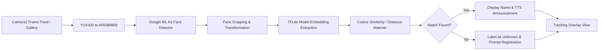

# 🎭 Realtime Face Recognition Android App

[](https://kotlinlang.org/)
[](https://developer.android.com/)
[](https://www.tensorflow.org/lite)
[](https://developers.google.com/ml-kit)
[](https://gradle.org/)

An advanced, real-time Android application for face detection, face recognition, and face tracking using on-device machine learning with **Google ML Kit** and **TensorFlow Lite (FaceNet / MobileFaceNet)**.

---

## 🚀 Key Features

- **⚡ Real-Time Face Detection**: Powered by Google ML Kit Vision Face Detection API running directly on camera frames.
- **🧠 High-Accuracy Face Recognition**: Employs deep-learning feature extraction embeddings via TensorFlow Lite (`facenet.tflite` / `mobile_face_net.tflite`) and vector similarity comparison.
- **🔄 Seamless Camera Switching**: Supports both Front and Back cameras with automatic sensor orientation alignment using Android Camera2 API.
- **🗂️ Local Face Database**: Secure, on-device SQLite database (`DBHelper`) storing registered face embeddings, preview thumbnails, and person identities.
- **🖼️ Dual Registration Modes**:
  - **Live Camera Capture**: Register faces on-the-fly directly from the live feed.
  - **Gallery Import**: Pick photos from the phone gallery with automatic facial cropping and feature embedding extraction.
- **🗣️ Audio & Speech Feedback**:
  - **Text-To-Speech (TTS)**: Audible greetings announcing detected persons or alerting on unknown individuals.
  - **Speech Recognizer**: Voice-driven trigger capabilities.
- **🎛️ Face Management Suite**: Browse registered individuals in a clean RecyclerView interface with full edit name and delete controls.
- **🎯 Visual Tracking Overlay**: Dynamic bounding box tracking overlay (`MultiBoxTracker`, `BorderedText`, `OverlayView`) with real-time recognition labels.

---

## 🛠️ Architecture & Pipeline



---

## 📁 Project Structure

```
RealtimeFaceRecognition/
├── app/
│   ├── src/
│   │   ├── main/
│   │   │   ├── assets/
│   │   │   │   ├── facenet.tflite           # 512-d FaceNet TFLite model
│   │   │   │   └── mobile_face_net.tflite   # Lightweight MobileFaceNet TFLite model
│   │   │   ├── java/com/example/imageclassificationlivefeed/
│   │   │   │   ├── DB/                      # SQLite Helper for local face storage
│   │   │   │   ├── Drawing/                 # MultiBoxTracker & OverlayView canvas
│   │   │   │   ├── LiveFeed/                # CameraConnectionFragment & AutoFitTextureView
│   │   │   │   ├── face_recognition/        # TFLite inference & FaceClassifier interface
│   │   │   │   ├── MainActivity.kt          # Main camera feed & recognition loop
│   │   │   │   ├── FaceAdapter.kt           # RecyclerView adapter for saved faces
│   │   │   │   └── savedPerson.kt           # Face database manager activity
│   │   │   ├── res/                         # UI layouts, drawables, dialogs, themes
│   │   │   └── AndroidManifest.xml
│   │   └── test/
│   ├── build.gradle                         # App module dependencies
│   └── proguard-rules.pro
├── gradle/wrapper/
├── build.gradle                             # Root build script
├── settings.gradle
├── gradle.properties
└── README.md
```

---

## ⚙️ Tech Stack & Dependencies

| Component | Technology |
|---|---|
| **Language** | Kotlin |
| **Min SDK / Target SDK** | 24 (Android 7.0) / 34 (Android 14) |
| **Face Detection** | `com.google.mlkit:face-detection:16.1.5` |
| **Machine Learning** | `org.tensorflow:tensorflow-lite:+` |
| **Camera** | Android Camera2 API (`android.hardware.camera2`) |
| **UI Components** | Android Material Design 3, ConstraintLayout, RecyclerView |
| **Storage** | SQLite Database |

---

## 📱 Getting Started

### Prerequisites

- **Android Studio** (Koala / Hedgehog / Iguana or newer)
- **Android SDK** API 34 installed
- Physical Android device (recommended for camera testing) or emulator with camera emulation enabled
- **JDK 17** or **JDK 1.8**

### Installation

1. **Clone the repository:**
   ```bash
   git clone https://github.com/Yuvraj9198/RealtimeFaceRecognition.git
   cd RealtimeFaceRecognition
   ```

2. **Open in Android Studio:**
   - Launch Android Studio.
   - Select **Open an Existing Project** and choose the `RealtimeFaceRecognition` folder.
   - Wait for Gradle sync to complete.

3. **Run on Device:**
   - Connect your Android device with USB Debugging enabled.
   - Click the green **Run (`Shift + F10`)** button in Android Studio.

### Required Permissions

The app will prompt for the following runtime permissions:
- `android.permission.CAMERA`: Live video stream processing
- `android.permission.RECORD_AUDIO`: Voice input interaction
- `android.permission.READ_MEDIA_IMAGES` / `READ_EXTERNAL_STORAGE`: Gallery image face registration

---

## 👤 Author

**Yuvraj Kaushik**
- GitHub: [@Yuvraj9198](https://github.com/Yuvraj9198)

---

## 📄 License

This project is licensed under the [MIT License](LICENSE) - see the LICENSE file for details.
